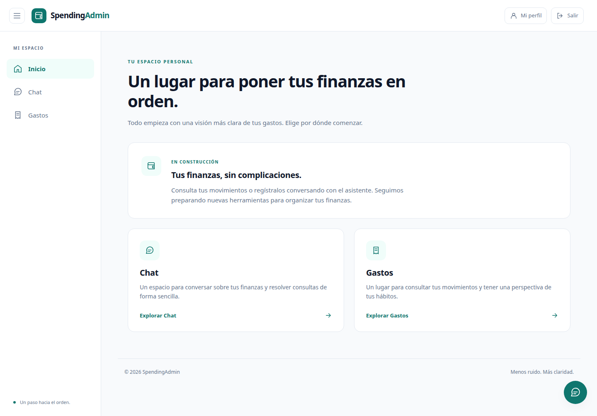
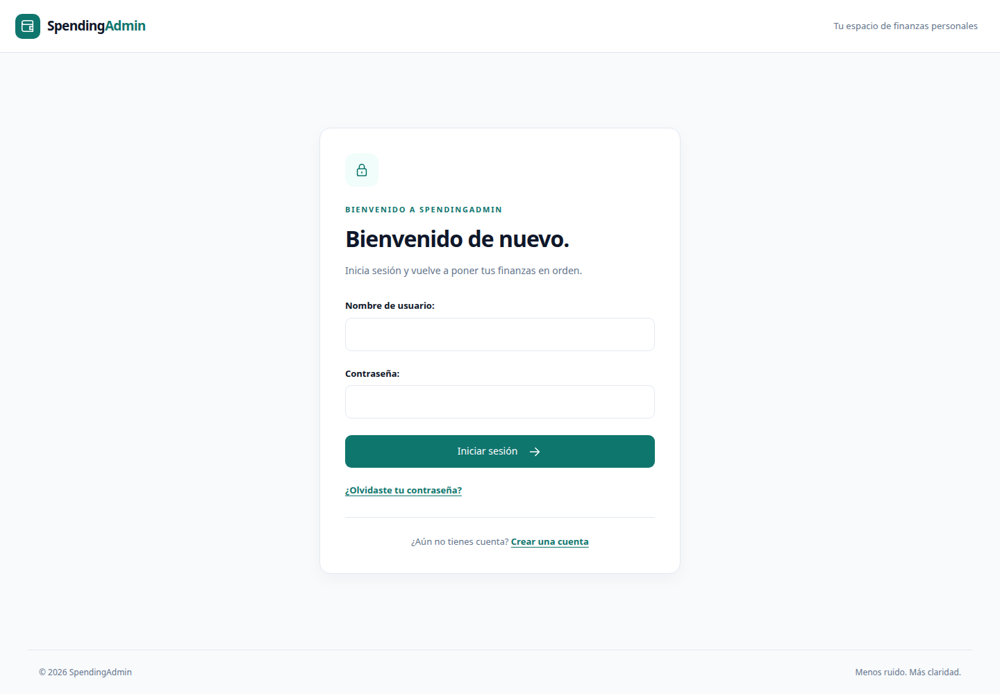
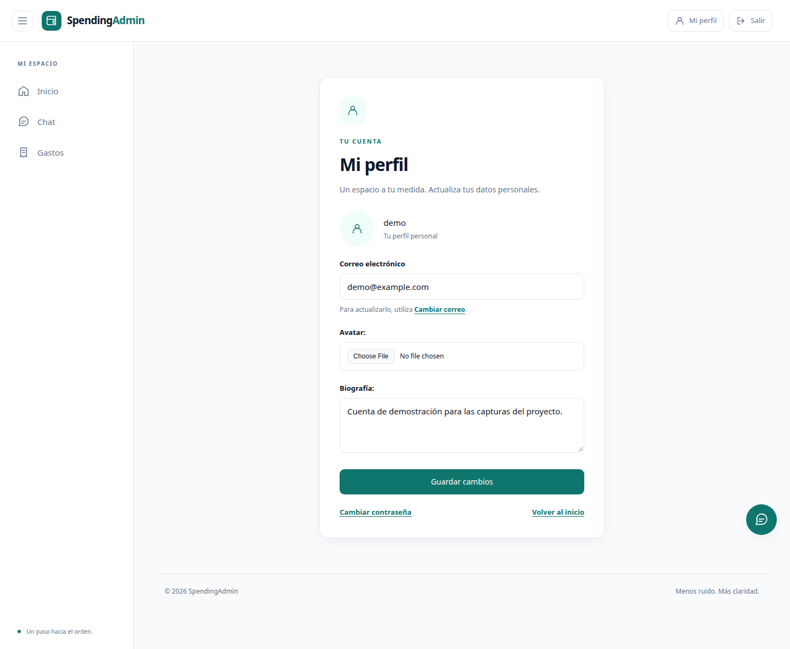
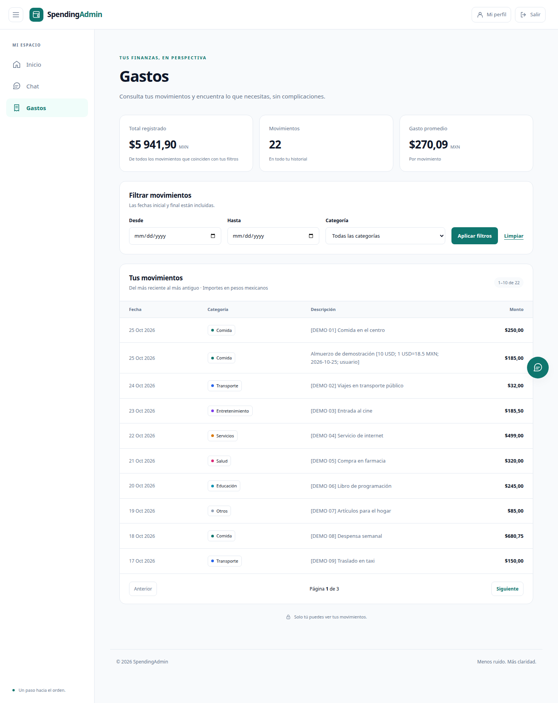
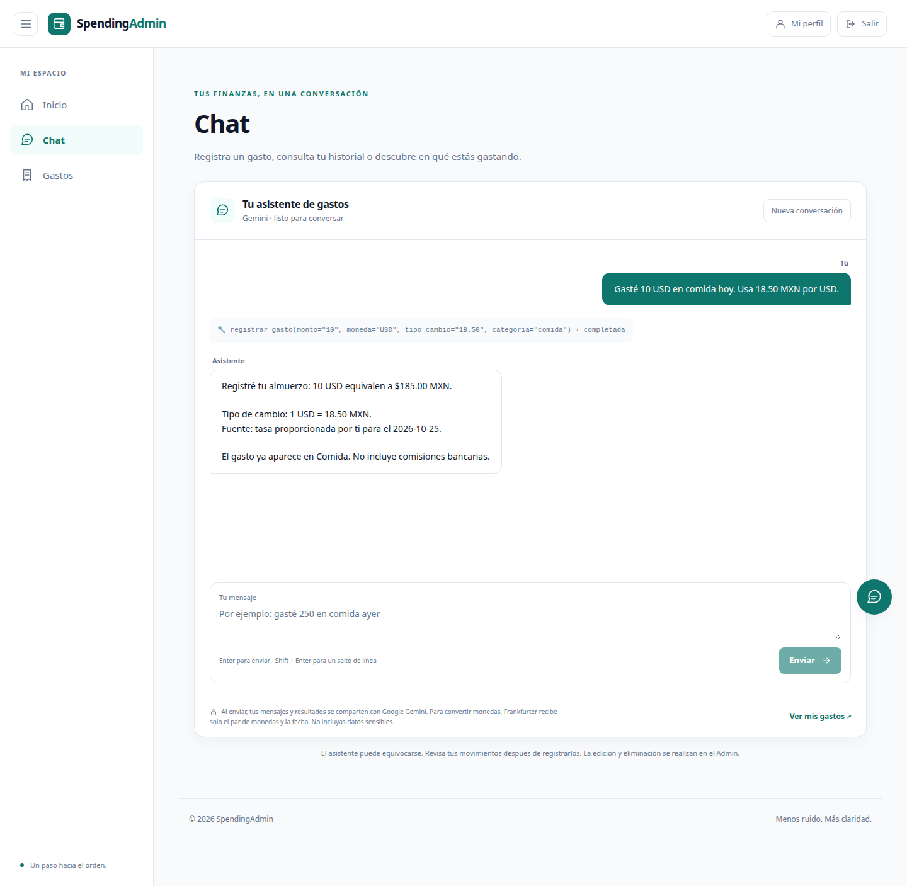
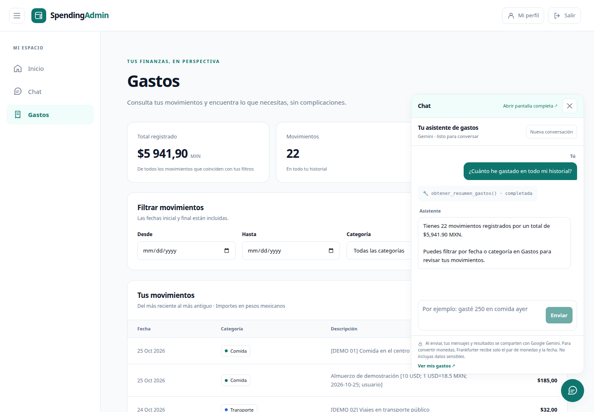
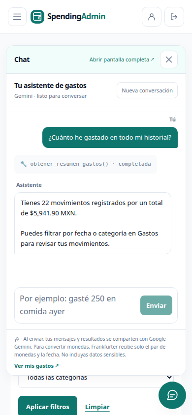
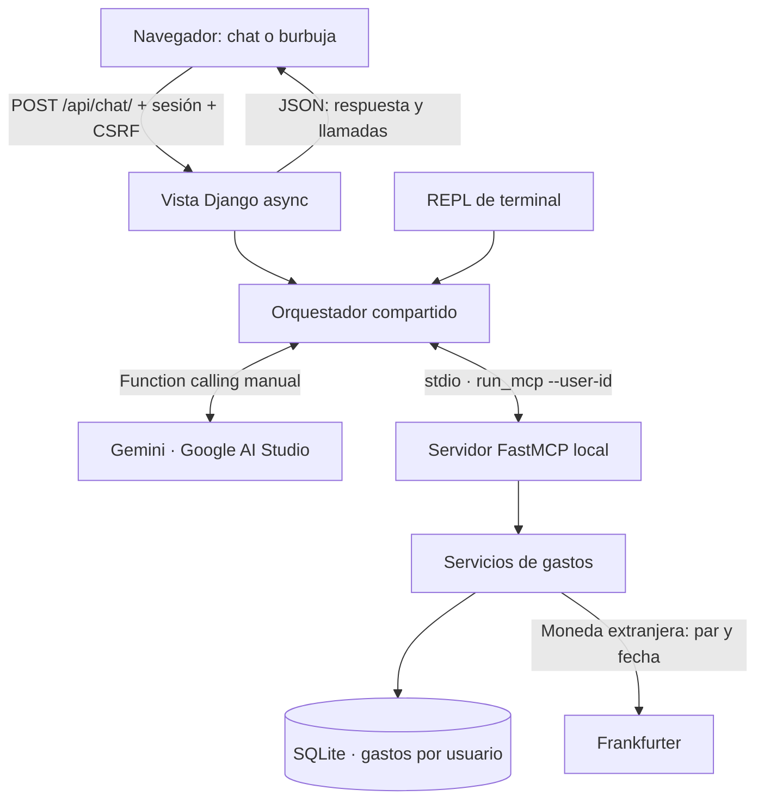

# SpendingAdmin

**Menos ruido. Más claridad.** Gestor de gastos personales con Django, un asistente
conversacional de Google AI Studio y herramientas locales expuestas mediante FastMCP.

Permite consultar movimientos, registrar gastos con lenguaje natural y convertir
monedas extranjeras a pesos mexicanos. Cada usuario trabaja únicamente con sus
propios gastos.



## Contenido

- [Funcionalidades y capturas](#funcionalidades-y-capturas)
- [Arquitectura](#arquitectura)
- [Instalación y configuración](#instalación-y-configuración)
- [Uso y datos de demostración](#uso-y-datos-de-demostración)
- [Conversión de monedas](#conversión-de-monedas)
- [Tolerancia a fallas y seguridad](#tolerancia-a-fallas-y-seguridad)
- [Pruebas](#pruebas)
- [Solución de problemas](#solución-de-problemas)
- [Alcance actual](#alcance-actual)

## Funcionalidades y capturas

> Las capturas se tomaron de la interfaz real con una cuenta ficticia y una base
> SQLite aislada. Las respuestas y trazas del chat de las capturas son **simuladas**;
> no representan una ejecución real de Gemini. El ejemplo de conversión usa una
> tasa manual ilustrativa de **18.50 MXN por USD**, no una cotización vigente.
> No se incluyen credenciales ni datos financieros personales.

### Acceso y cuenta

- Registro con email obligatorio y único.
- Inicio y cierre de sesión; el cierre usa POST con protección CSRF.
- Perfil con biografía y avatar, cambio de email y flujos nativos de contraseña.
- Al abrir la aplicación sin sesión, se muestra el login.
- En desarrollo, los correos de recuperación se imprimen en la terminal del servidor.



<details>
<summary>Ver captura del perfil</summary>



</details>

### Consulta de gastos

El listado muestra total, cantidad y promedio de **todos los movimientos que
coinciden con los filtros**, no solo los de la página visible. Incluye filtros
por categoría y fechas inclusivas, orden del más reciente al más antiguo y
paginación de 10 movimientos.

Los importes se guardan en MXN. Las categorías disponibles son Comida, Transporte,
Entretenimiento, Servicios, Salud, Educación y Otros.



### Chat con herramientas

El asistente puede registrar un gasto, consultar un resumen o listar los últimos
movimientos. La interfaz muestra el texto de respuesta y las herramientas utilizadas.

Ejemplos para probar con tu cuenta:

```text
Gasté 250 MXN en comida ayer.
¿Cuánto llevo gastado este mes en transporte?
Muéstrame mis últimos cinco gastos.
Gasté 10 USD en comida ayer.
Gasté 10 EUR en transporte. Usa 20.10 MXN por EUR.
```

**Enter** envía; **Shift + Enter** agrega un salto de línea. Las sugerencias solo
rellenan el mensaje. «Nueva conversación» pide confirmación y borra el historial,
pero **no elimina gastos**. Se conservan hasta 20 mensajes de texto en la sesión
del navegador; no existe un historial permanente asociado a la cuenta.



### Burbuja global y móvil

La burbuja inferior derecha abre un panel sin abandonar la vista actual. Está
disponible en las páginas de la aplicación con sesión iniciada, incluido el perfil.
Comparte el historial con el chat principal y permite minimizar, cerrar con
**Escape** o abrir la pantalla completa.

El panel se carga al abrirlo por primera vez. Abrirlo no invoca Gemini. En una
misma página, ambas interfaces comparten bloqueo de envío y se sincronizan al
recibir una respuesta o limpiar la conversación.



<details>
<summary>Ver versión móvil</summary>



</details>

## Arquitectura

| Componente | Tecnología y responsabilidad |
|---|---|
| Aplicación web | Django 6.1.2: vistas, autenticación, sesiones y Admin |
| Datos | SQLite y ORM de Django; importes con `DecimalField` |
| Interfaz | Templates, CSS y JavaScript plano; sin compilación de frontend |
| Herramientas | `FastMCP` del SDK oficial `mcp` 1.x, con transporte stdio |
| Modelo | Gemini Developer API mediante Google AI Studio y `google-genai` |
| Conversión | Frankfurter v2 mediante HTTPX y cálculo con `Decimal` |
| Fecha local | `America/Mexico_City`, correspondiente a Guadalajara |



Gemini decide qué herramienta solicitar; **el backend ejecuta la operación**.
El orquestador descubre los esquemas MCP, oculta `user_id` al modelo, inyecta
el usuario autenticado y devuelve los resultados a Gemini para obtener la
respuesta final. La pantalla web y el REPL reutilizan ese mismo bucle.

```text
ProyectoFinal/
├── manage.py
├── requirements.txt
├── .env.example
├── SpendingAdmin/          # Configuración, rutas generales y entorno
├── core/                   # Inicio, layout, header, sidebar y footer
├── registration/           # Cuentas, Profile, formularios y contraseñas
├── spending/               # Gasto, servicios, Admin y listado
│   ├── exchange.py         # Tasas y conversión a MXN
│   ├── mcp_server.py       # Herramientas FastMCP
│   └── management/commands/
│       ├── run_mcp.py
│       └── seed_gastos.py
├── chat/
│   ├── orchestrator.py     # Bucle Gemini ↔ MCP
│   ├── prompts.py          # Reglas del asistente
│   ├── repl.py             # Cliente de terminal
│   ├── templates/chat/     # Chat completo, panel compartido y burbuja
│   ├── static/chat/        # CSS y JS del chat
│   └── tests/
└── docs/
    ├── Context.md          # Contexto técnico detallado
    └── screenshots/        # Capturas incluidas en esta guía
```

`Profile` pertenece a `registration`; no existe una app independiente llamada
`profiles`. Consulta [el contexto técnico](docs/Context.md) para el detalle de
las convenciones y decisiones.

## Instalación y configuración

### Requisitos

- **Python 3.12 o superior**, compatible con las versiones de
  [requirements.txt](requirements.txt). Entorno verificado: Python 3.12.3.
- `pip` y soporte para entornos virtuales.
- Navegador con JavaScript para conversar; el listado funciona sin JavaScript.
- Conexión y una API key de [Google AI Studio](https://aistudio.google.com/)
  para usar Gemini. Cuentas, Admin, listado y pruebas no necesitan esa clave.
- Acceso a [Frankfurter](https://frankfurter.dev/) para tasas automáticas;
  no requiere otra API key.

No necesitas Node.js, Docker ni ejecutar un servidor MCP por separado para
usar el chat web.

### 1. Clonar e instalar

Los comandos siguientes son para Linux/macOS:

```bash
git clone https://github.com/Leonardosep13/Computacion_Tolerante_Fallas.git
cd Computacion_Tolerante_Fallas/ProyectoFinal
python3 -m venv .venv
source .venv/bin/activate
python -m pip install -r requirements.txt
cp .env.example .env
chmod 600 .env
```

En Windows PowerShell, desde `ProyectoFinal`, el equivalente es:

```powershell
py -3.12 -m venv .venv
.\.venv\Scripts\Activate.ps1
python -m pip install -r requirements.txt
Copy-Item .env.example .env
```

Los comandos siguientes asumen el entorno virtual activado y que estás dentro
de `ProyectoFinal`, junto a `manage.py`.

### 2. Configurar el entorno

Genera una clave de Django y pega el resultado en `DJANGO_SECRET_KEY` de tu
archivo `.env`:

```bash
python -c "import secrets; print(secrets.token_urlsafe(64))"
```

Configura estas variables; no copies los marcadores literalmente:

```dotenv
DJANGO_SECRET_KEY=<clave-aleatoria-generada-localmente>
DEBUG=True
ALLOWED_HOSTS=localhost,127.0.0.1,[::1]
GEMINI_API_KEY=<tu-clave-de-google-ai-studio>
GEMINI_MODEL=<modelo-disponible-en-tu-cuenta-con-function-calling>
USER_ID=
```

| Variable | Uso |
|---|---|
| `DJANGO_SECRET_KEY` | Obligatoria para arrancar; mantenla estable y privada |
| `DEBUG` | Desarrollo: `True`; por defecto es `False` |
| `ALLOWED_HOSTS` | Hosts sin esquema ni puerto, separados por comas; obligatorio con `DEBUG=False` |
| `GEMINI_API_KEY` | Solo obligatoria para conversar |
| `GEMINI_MODEL` | Nombre del modelo habilitado para tu cuenta; no hay modelo por defecto |
| `USER_ID` | Opcional, solo para el REPL; nunca selecciona al usuario web |

Puedes dejar las dos variables de Gemini vacías para explorar la aplicación
sin IA: el chat mostrará «Configuración pendiente». No pongas claves en el
JavaScript ni las subas a Git. `.env` está ignorado; `.env.example` sí se versiona.
Las variables del proceso prevalecen sobre `.env`. **Reinicia Django después
de cambiar la configuración**.

### 3. Crear tablas y arrancar

```bash
python manage.py migrate
python manage.py check
python manage.py runserver
```

Abre <http://127.0.0.1:8000/> y crea una cuenta desde «Crear una cuenta».
No hay credenciales de demostración predefinidas.

Para acceder al Admin, crea además una cuenta administrativa:

```bash
python manage.py createsuperuser
```

Abre <http://127.0.0.1:8000/admin/> e inicia sesión con esa cuenta.
El menú lateral muestra **Administración** solo a usuarios activos con
`is_staff=True`. El registro público nunca concede ese permiso. Un usuario
staff necesita además permisos sobre cada modelo; un superusuario los tiene
todos. El aislamiento de gastos y perfiles por propietario se conserva:
no se transfieren los gastos de una cuenta normal a la administrativa.

`runserver` es exclusivamente un servidor de desarrollo. El correo está
configurado con backend de consola: los enlaces de recuperación se muestran
en la terminal, no se envían a una bandeja real.

## Uso y datos de demostración

1. Regístrate e inicia sesión. Sin un destino `next`, el login abre tu perfil.
2. Usa Inicio, Chat y Gastos desde la sidebar; se contrae en escritorio y se
   despliega en móvil.
3. Registra gastos desde el chat o desde el Admin. En Gastos puedes consultar,
   filtrar y paginar, pero no hay un formulario CRUD propio.
4. Comprueba el movimiento en Gastos después de registrarlo. Recarga el listado
   para ver los cambios si el chat flotante estaba abierto sobre él.
5. Edita o elimina desde el Admin con una cuenta autorizada. Sus gastos siguen
   siendo independientes de los de otras cuentas, incluso siendo superusuario.

Para cargar datos ficticios, primero crea tu cuenta y sustituye `TU_USUARIO`:

```bash
python manage.py seed_gastos --username TU_USUARIO
```

Crea 21 movimientos etiquetados `[DEMO NN]`, repartidos entre las siete
categorías y varias fechas. Es idempotente por usuario: repetirlo no duplica
los datos ni actualiza los registros demo existentes. **Escribe en la base de
datos activa**; usa una cuenta de prueba. No proporciona una cuenta ni una
contraseña. Las capturas incluyen además un gasto extranjero ficticio para
mostrar la referencia de conversión.

### Rutas principales

| Ruta | Función |
|---|---|
| `/` | Inicio; requiere sesión |
| `/accounts/signup/` y `/accounts/login/` | Registro y acceso |
| `/accounts/profile/` | Perfil del usuario autenticado |
| `/accounts/password/reset/` | Recuperación de contraseña |
| `/gastos/` | Listado y resumen filtrado |
| `/chat/` | Chat completo |
| `/chat/panel/` | Fragmento HTML protegido de la burbuja |
| `/api/chat/` | POST JSON `{"mensaje": "..."}`; sesión y CSRF |
| `/api/chat/limpiar/` | POST; limpia solo el historial |
| `/admin/` | Administración de gastos con permisos nativos |

### REPL y servidor MCP

Para conversar desde la terminal:

```bash
python -m chat.repl
```

Usa `USER_ID` del entorno o solicita al iniciar el ID de un usuario activo.
Comandos: `/limpiar` reinicia la conversación y `/salir` termina.

Para probar el servidor MCP directamente con un cliente compatible:

```bash
python manage.py run_mcp --user-id 1
```

Sustituye `1` por el ID real de tu cuenta de prueba. Este comando **no es un
chat ni un servidor HTTP**: espera mensajes MCP por stdio. Su stdout se reserva
para JSON-RPC. En el chat web, el orquestador inicia y cierra este subproceso
automáticamente con el usuario de la sesión.

Herramientas expuestas: `registrar_gasto`, `obtener_resumen_gastos` y `listar_gastos`.

## Conversión de monedas

Todo gasto se almacena y suma en **MXN**:

1. Gemini extrae monto **original**, moneda ISO, categoría y fecha.
2. Para una moneda extranjera, el backend consulta la tasa de Frankfurter
   correspondiente a la fecha del gasto.
3. Valida el par de monedas, tasa y fecha; calcula con `Decimal` y redondea a
   dos decimales mediante `ROUND_HALF_UP`.
4. Guarda el importe en MXN y una referencia del origen en la descripción.
5. El asistente debe confirmar importe original, pesos guardados, tasa, fecha
   y fuente devueltos por la herramienta.

Sin moneda indicada ni contexto extranjero, se usa MXN. «Dólares» sin país
requiere aclaración según el prompt: USD, CAD y AUD no son equivalentes.
Si la API no cubre la moneda o falla, **no se registra el gasto**: se pide una
tasa explícita en MXN por unidad extranjera o el cargo final en pesos.

También puedes indicar la tasa:

```text
Gasté 10 USD en comida hoy; usa 18.50 MXN por USD.
```

En este ejemplo ilustrativo se guardan **185.00 MXN**, con fuente `usuario`,
sin consultar Frankfurter. La atribución de una tasa al mensaje del usuario
depende del prompt; el backend valida su formato y rango.

Las cotizaciones públicas son de referencia, no garantizan el cargo del banco
ni incluyen comisiones. Se admiten tasas anteriores de hasta siete días para
cubrir días sin publicación, indicando la fecha real usada. Se rechazan tasas
futuras o demasiado antiguas y conversiones de gastos con fecha futura.
Una moneda no soportada no se sustituye silenciosamente por otra.

## Tolerancia a fallas y seguridad

| Situación | Comportamiento |
|---|---|
| Configuración de Gemini ausente | Estado informativo y error 503; el resto de la aplicación sigue disponible |
| Mensaje inválido | Rechazo antes de llamar al modelo; máximo 2000 caracteres |
| Cuota de Gemini agotada | Error 429, sin reintento automático de registros |
| Timeout | Error explícito; límite global de 90 s, Gemini 30 s y espera MCP 20 s |
| Consulta de tasas fallida | Timeout HTTP de 8 s por fase; no guarda el gasto y solicita alternativa |
| Tasa o importe inválido | Rechazo de negativos, no finitos, fechas incorrectas y resultados fuera de rango |
| Fallo después de ejecutar herramientas | Conserva trazas y avisa de posibles operaciones aplicadas; revisar Gastos antes de repetir |
| Sesión expirada | Se bloquea el envío y se ofrece iniciar sesión |
| Panel flotante no disponible | Error visible, reintento y enlace al chat completo |
| Solicitud inválida, acceso denegado o ruta inexistente | Pantallas 400, 403 y 404 con navegación segura; mantienen su código HTTP |
| Error inesperado del servidor | Pantalla 500 sin detalles internos; advierte revisar gastos antes de repetir operaciones |
| Validación CSRF fallida | Pantalla 403 con indicaciones para volver a abrir el formulario o iniciar sesión; no desactiva la protección |
| Error global en `/api/` | JSON con campo `error` y código HTTP original, incluido CSRF; no entrega HTML al cliente de chat |

### Pantallas de error

Los handlers globales están en `core/errors.py`. Su plantilla independiente
conserva la paleta y ofrece **Volver al inicio** e **Iniciar sesión**, sin
consultar usuarios, sesiones, base de datos ni servicios externos. No incluye
sidebar ni chat: evita que el componente que falló vuelva a romper la pantalla.
El CSS esencial está integrado, con colores de respaldo si no cargan los
estáticos. Funciona sin JavaScript.

Las respuestas no se almacenan en caché, no revelan excepciones ni parámetros
privados y mantienen el registro normal de Django en el servidor. No hay
redirecciones ni reenvíos automáticos de formularios. Los errores de validación
ya atendidos por una vista conservan su comportamiento y sus mensajes.

**Django usa estas pantallas 400, 404 y 500 con `DEBUG=False`.** En desarrollo,
`DEBUG=True` mantiene las páginas técnicas para depurar; CSRF y permisos usan
las pantallas seguras también en desarrollo. Para verificarlas localmente sin
cambiar tu `.env`, en Linux/macOS:

```bash
DEBUG=False ALLOWED_HOSTS=localhost,127.0.0.1 python manage.py runserver --insecure
```

Visita una ruta inexistente, por ejemplo `/pagina-inexistente/`. `--insecure`
se usa **solo para esta prueba local**: permite servir estáticos desde
`runserver` con debug desactivado. En producción configura un servidor de
estáticos, `DEBUG=False` y tus hosts reales. Las pruebas provocan el 500 de
forma aislada; no existe una ruta pública para forzar fallos.

Estas pantallas permiten recuperarse de un error, pero no reparan por sí solas
una caída de la base de datos o del servidor. Si Django no puede arrancar,
la página de indisponibilidad debe servirla el proxy o servidor de despliegue.

### Protección de operaciones y datos

- Máximo **5 rondas de modelo** y **10 herramientas** por solicitud.
- Montos persistidos entre **0.01 y 99999999.99 MXN**; no se usan floats para
  calcular dinero. Las descripciones admiten 200 caracteres, incluida la
  referencia de conversión.
- Usuario impuesto por el servidor, consultas filtradas por propietario y
  validación adicional en el proceso MCP.
- POST protegido con CSRF. Las respuestas se insertan como texto, no como HTML
  ni Markdown ejecutable.
- Sin borrado o edición mediante chat; no se exponen esas herramientas.
- El bloqueo de envíos simultáneos es de la interfaz de una página, **no** un
  bloqueo entre pestañas ni una garantía de idempotencia distribuida.
- No se puede revertir una escritura ya confirmada solo porque falle después
  la respuesta de Gemini. No repitas a ciegas una solicitud interrumpida.

**Privacidad:** al enviar un mensaje, su texto, el contexto y los resultados de
las herramientas se comparten con Google Gemini. Frankfurter recibe solo el
par de monedas y la fecha, nunca el usuario, importe o descripción. No incluyas
datos sensibles. Las claves permanecen en el servidor.

## Pruebas

Desde `ProyectoFinal`, con el entorno activado:

```bash
python manage.py test
python manage.py check
python manage.py makemigrations --check --dry-run
python -m pip check
```

**Última verificación: 187 pruebas exitosas**, sin errores de checks ni
migraciones pendientes. El número puede cambiar al agregar funcionalidades.

| Área | Comprobaciones |
|---|---|
| Cuentas | Señales de Profile, registro, formularios, permisos y cambios de contraseña/email |
| Gastos | Montos, filtros, sumas exactas, paginación, Admin y aislamiento |
| Chat y burbuja | Sesión, CSRF, historial compartido, escape seguro, carga parcial y configuración ausente |
| Orquestador | Esquemas, dueño inyectado, firmas/IDs, límites, errores y resultados de tools |
| SDK Gemini | Transporte HTTP simulado con serialización real, incluida la segunda petición después de MCP |
| MCP | Subproceso stdio real con SQLite temporal y operaciones aisladas |
| Monedas | HTTP simulado, tasas históricas, precisión, validación, errores y recuperación manual |
| Errores y Admin | 400/403/404/500 reales con debug desactivado, JSON/CSRF, logging, render sin BD/sesión y acceso staff sin elevar permisos |

Las pruebas automatizadas no requieren claves reales ni consumen cuota de
Gemini o Frankfurter. Se probaron también navegación, teclado, envío simulado
y diseño móvil en navegador. Esto no sustituye una evaluación de las respuestas
del modelo real: comprueba tu modelo y cuota con datos ficticios antes de una demo.

## Solución de problemas

| Problema | Revisar |
|---|---|
| `manage.py` no se encuentra | Ejecuta los comandos desde `ProyectoFinal`, no desde la raíz del repositorio |
| Falta `DJANGO_SECRET_KEY` | Copia `.env.example` a `.env` y genera una clave |
| `DisallowedHost` | Agrega el host utilizado a `ALLOWED_HOSTS`, sin `http://` ni puerto |
| `no such table` | Ejecuta `python manage.py migrate` en el entorno correcto |
| Chat con «Configuración pendiente» | Completa `GEMINI_API_KEY` y `GEMINI_MODEL`, y reinicia Django |
| Gemini no responde o devuelve 429 | Comprueba modelo, acceso, conectividad y cuota de Google AI Studio |
| Tool completada, pero sin respuesta final | Puede existir un gasto guardado; revisa Gastos antes de reenviar |
| No aparece un gasto enviado desde la burbuja | Recarga el listado y revisa si hay filtros activos |
| No llega el correo de recuperación | En desarrollo, busca el enlace en la consola del servidor |
| Cambios de CSS/JS no visibles | Recarga sin caché con Ctrl + Shift + R |
| No accedes al Admin | Requiere una cuenta staff con permisos; puedes crear un superusuario |

## Alcance actual

Están implementados cuentas, perfil, layout compartido, listado de gastos,
chat completo/flotante, REPL, FastMCP y conversión a MXN.

Pendientes, **no incluidos como funciones actuales**:

- Dashboard con gráfica por categoría y Chart.js.
- Endpoint `/api/resumen/` y refresco automático de la tabla tras conversar.
- Edición/eliminación mediante chat con confirmación.
- Historial permanente de conversaciones entre sesiones.
- Configuración de producción: HTTPS, servidor ASGI/WSGI, estáticos, correo
  real, backups y políticas operativas.

Para producción no basta con `DEBUG=False`: configura HTTPS, cookies seguras,
hosts reales, entrega de estáticos/media y correo, y revisa `check --deploy`.
No publiques la base SQLite, archivos de media privados ni secretos.
